# A few notes on busk.town

Hi busk.town team,

Thank you for the site. The charts are a pleasure to play from: the chords sit with the words, the sections are labelled, and changing key is right there when I need it. I spent a little time on my phone the way I would at rehearsal, and noticed a few small things. I'm sharing them in case they're useful.

## The song could sit a little higher

The chart itself is easy to read. On the phone, a large ad sits above it, so the title and the first chords begin further down. When a friend sends me a link during practice, it would help if the song were the first thing on the screen. The X in the ad's corner opens a note about removing ads through LINE, so there isn't a quick way to tuck it away. The ad could live a little further down the page.

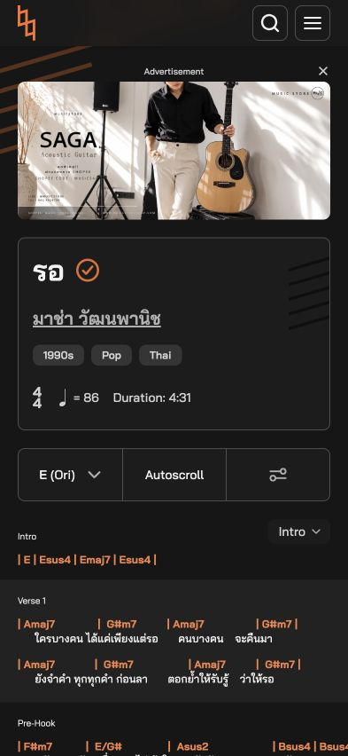

## Some lines run past the edge of the phone

Sliding a line sideways does bring the rest into view. I just have to remember that extra move while I'm playing. If the line wrapped, or fitted the phone, I could keep singing.

In *รอ*, the last Bsus4 of the Pre-Hook is cut off at the edge. One step down on Font size brings it back, which is a handy escape hatch.

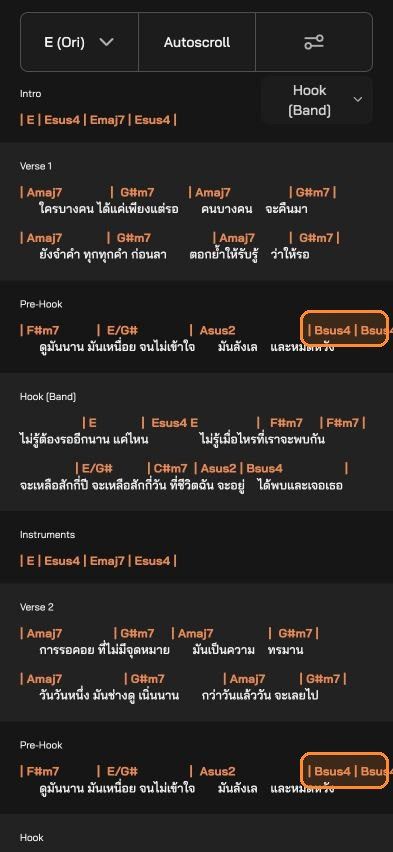

The words do this too. On most of the songs I opened, at least one lyric line continues off the screen. In *(There's) No Gettin' Over Me*, Hook 2 ends mid-word: "I'll be the book that y…"

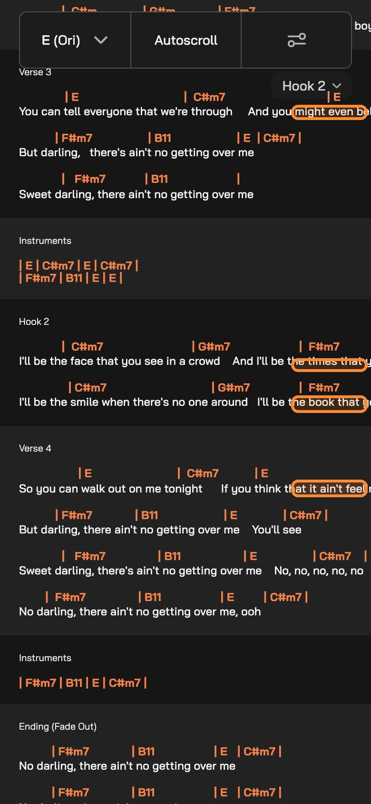

In *(เก็บใจใส่) กุญแจ*, the verse and the hook do the same. The hook line "อยากจะฟังนัก บอกว่ารักฉัน…" stops at "ถ้าเธอเฉลย พูดมาเ".

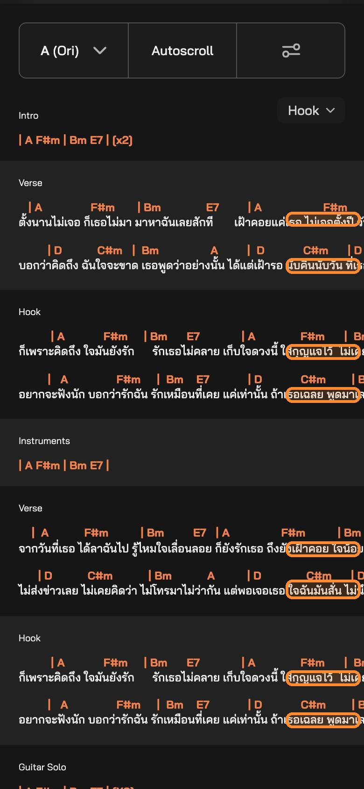

I saw the same thing on songs such as *1001 (You're Lovely)*, *11 นาฬิกา*, and *200%*. This was at the default text size, on songs from the front page.

## The section menu sometimes rests on the chart

The section menu is handy for jumping around a long song. While I was reading *รอ*, the floating "Bridge" label sat on the last chord and the end of the lyric. If it stayed up with the other controls, the chart underneath would stay clear.

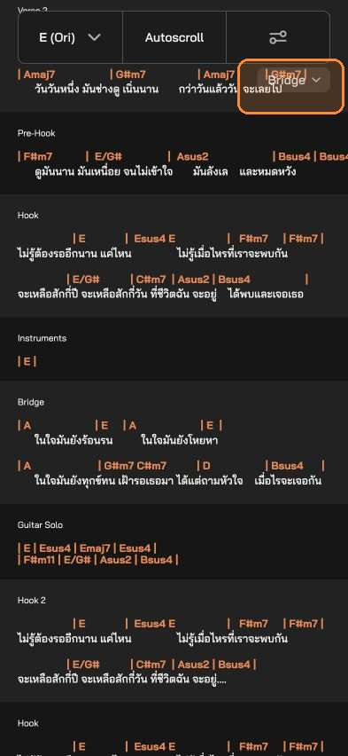

## A way to stop Autoscroll

Autoscroll is a nice touch when both hands are busy. Once it starts, the button becomes 60%, 100% and 150%, and nothing says stop. Touching the page or scrolling by hand doesn't stop it either. Tapping the speed that's already selected turns it off and brings the Autoscroll button back. I found that by trying it. A small Stop beside the speeds would save the guesswork when the singer pauses.

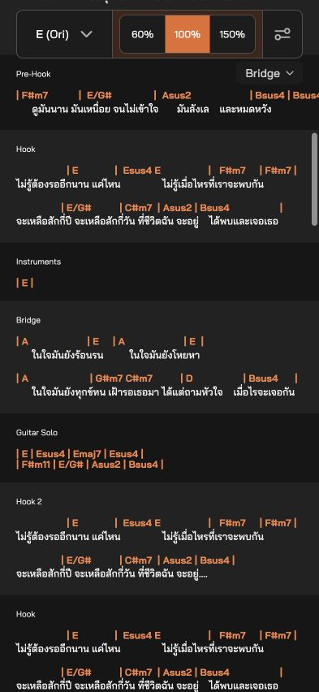

## Finding an artist by either name

Search is quick when I type the name the way it's listed. A few artists I know by another spelling didn't come up. `carabao` was empty, while `คาราบาว` found the artist and the songs. The other way around as well: `นิวจิ๋ว` was empty, and `NEW JIEW` worked. I nearly assumed those songs weren't there. Matching the Thai name and the English name would help.

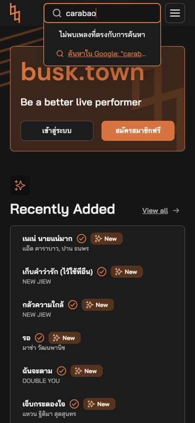 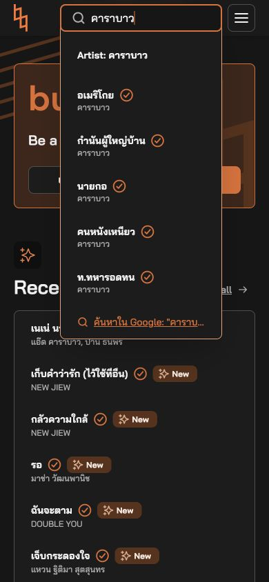

`carabao` is empty. `คาราบาว` works.

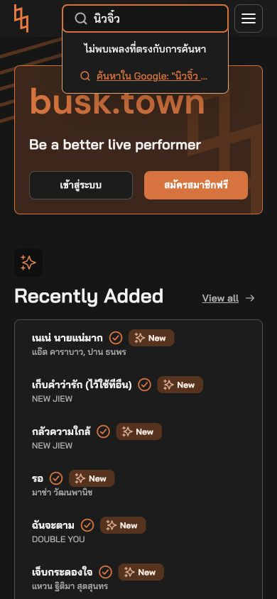 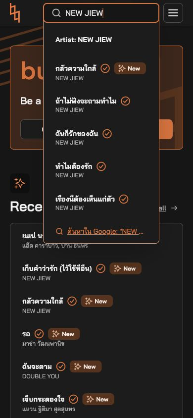

`นิวจิ๋ว` is empty. `NEW JIEW` works.

## Keeping a search when I come back

On NEW JIEW I searched `ไม่รัก`, sorted by Date Added, opened a song, and pressed Back. The search had cleared, and the list was every song again, sorted by title. If the search and the sort could stay as they were, comparing songs for a set would be a little easier.

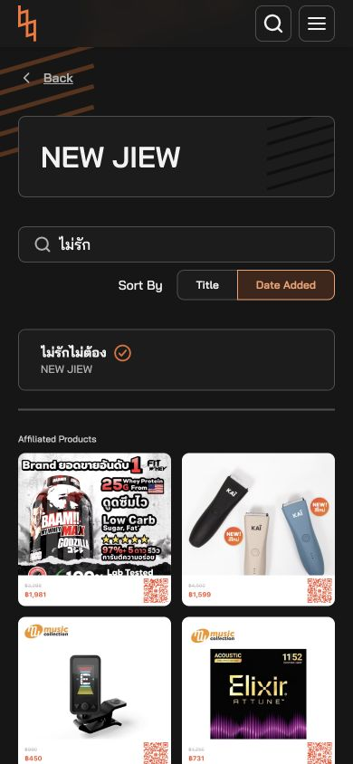 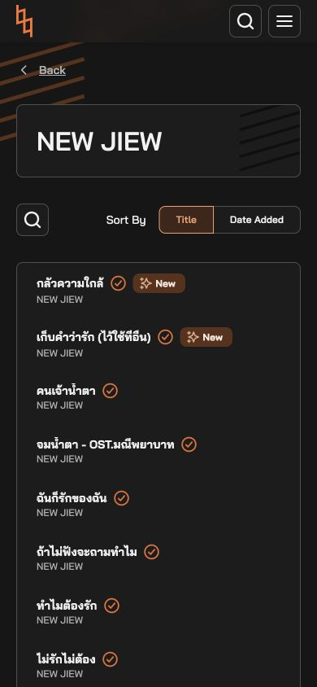

## A few things I'd love, when you have time to build

These aren't fixes. The key change, the metronome and the section jumps already got me through the song. I changed *รอ* down to C, closed the page, and it was still in C when I came back. That was a nice surprise. A few extras would help on a real gig.

**The shapes under a capo.** Changing key is easy, and that's what the singer needs. On guitar I often leave the easy shapes alone and clamp a capo. It would be lovely to see both: the key we're hearing, and "capo 2, play as if it's in D."

**Loop one part for practice.** Jumping to the Bridge is already handy. For practice I wanted to stay there: let Autoscroll run over that one section on repeat, with the metronome a little under the song's tempo, until it felt easy.

**Send the key I picked.** My browser remembered C. My bandmate's wouldn't. A link that opens the song in the key we rehearsed would save the usual message: "take it down from E."

**Tap the tempo.** The song's tempo and the click are a good start. Live, we rarely sit on the recorded speed. If I could tap along for a bar, the click could follow the room.

**Keep the video in a small window.** The YouTube embed is handy for checking a part by ear. As soon as I scroll down to the chart, the video is off the screen. If it could pop out into a little picture-in-picture window, the chord sheet and the video could stay in view together.

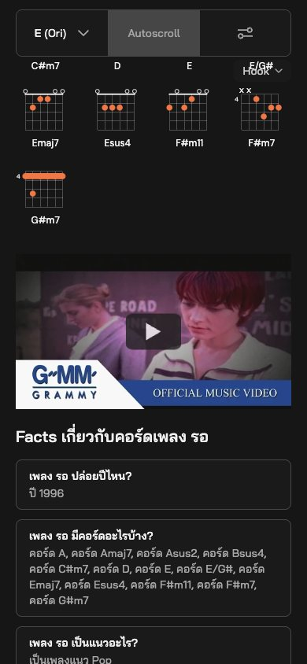 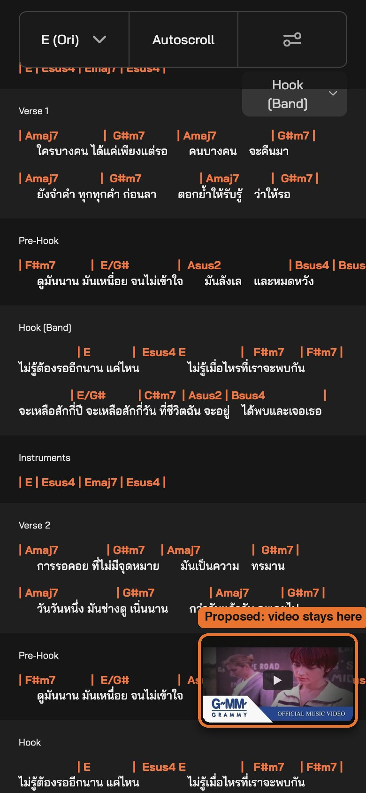

Today the video lives under the chord shapes at the end of the page. Reading Verse 1, it's about four and a half screens away. The second picture is a rough sketch of what I mean: a small window in the corner that stays put while the chart scrolls.

**A shorter skip back.** Double-tapping the YouTube player jumps 10 seconds. When I'm picking out a fast solo, a bass line or a melody, 10 seconds is a whole phrase too far. A busk.town button that steps back 2 seconds, maybe with a slower playback speed next to it, would let me stay on the one bar I'm trying to catch.

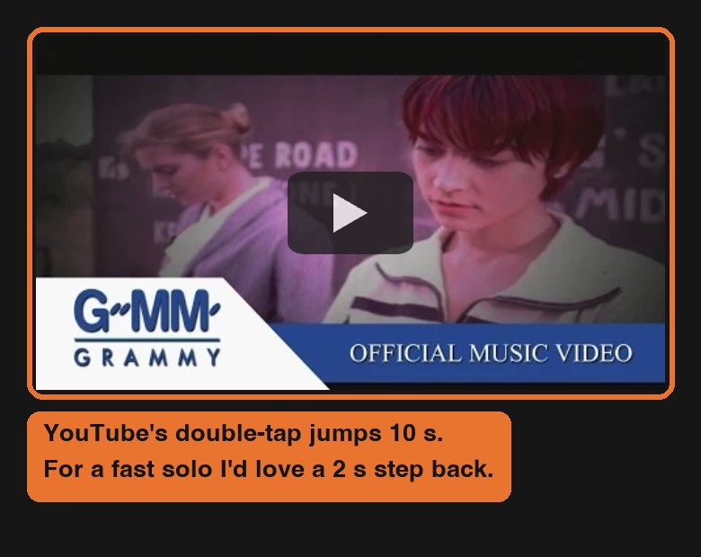

Play is the only control busk.town adds today. Everything after that is YouTube's own player.

## The three that would help me most

1. Let each line stay on the screen, chords and lyrics, and keep the section menu clear of the chart.
2. Show a Stop on Autoscroll.
3. Find an artist from either spelling.

Thank you again for the care that's already in these charts. Happy to explain any of this if it would help.

Checked on 7 October 2026, in a phone-width browser, without an account. A shorter copy: [FEEDBACK-SUMMARY.md](FEEDBACK-SUMMARY.md).
