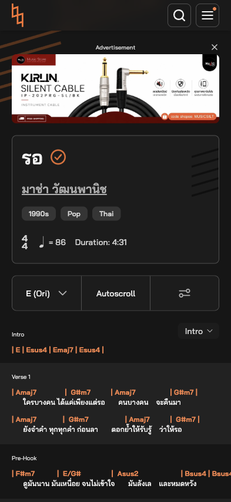
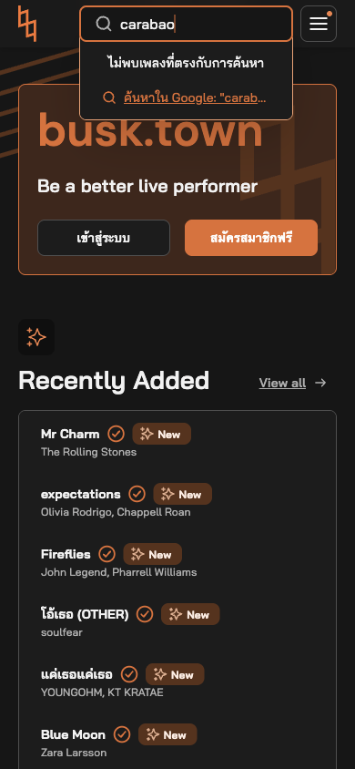
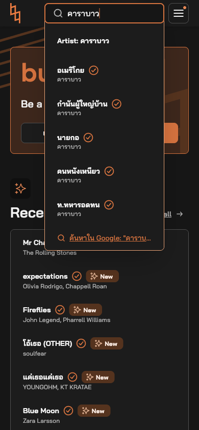
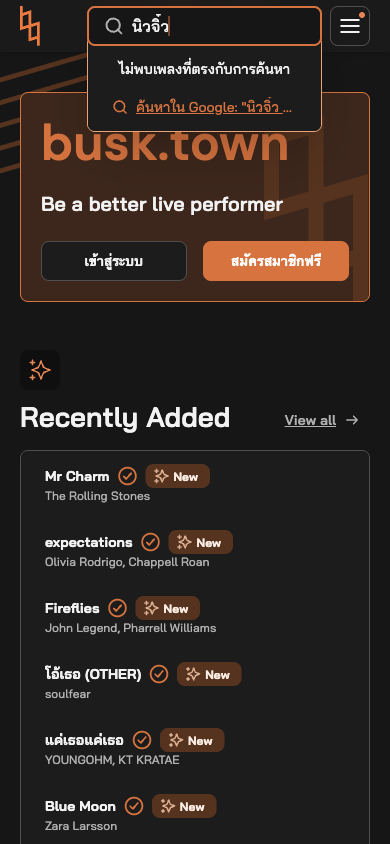
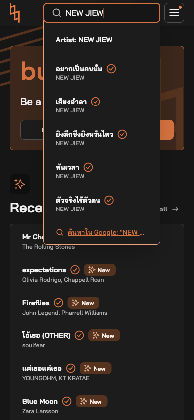
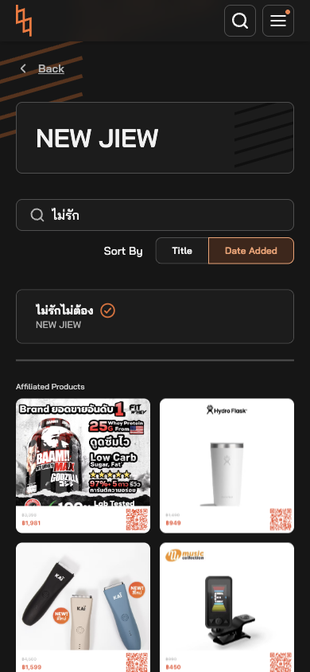
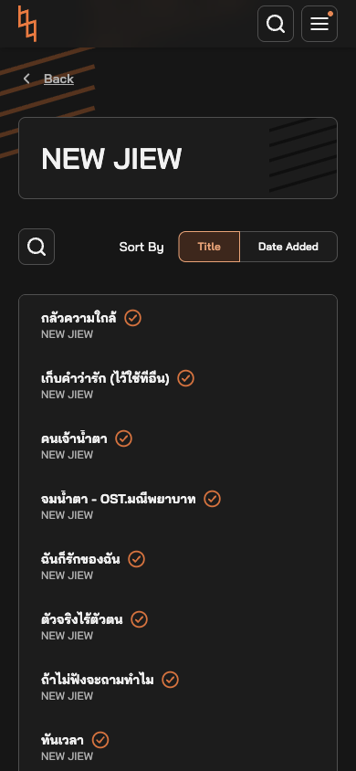
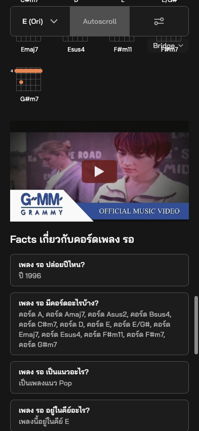

# A few notes on busk.town

Hi busk.town team,

Thank you for the site. The charts are a pleasure to play from: the chords sit with the words, the sections are labelled, and changing key is right there when I need it.

I was really surprised that the browser remembered my key change, too. I took [*รอ*](https://busk.town/songs/%E0%B8%A3%E0%B8%AD-masha) down to C, closed the page, and it was still in C when I opened it again. That was a nice touch.

I tried the charts at phone width, the way I'd read them at rehearsal, and had a few small suggestions. The first is about where the chart starts on the screen.

## The song could sit a little higher

The chart itself is easy to read. At phone width, a large ad sits above it, so the title and the first chords begin further down. When a friend sends me a link during practice, it would help if the song were the first thing on the screen. When I tried the X in the ad's corner, it opened a note about removing ads through LINE rather than hiding the ad. The ad could live a little further down the page.

## Some lines run past the edge of the phone

Sliding a line sideways does bring the rest into view. I just have to remember that extra move while I'm playing. If the line wrapped, or fitted the phone, I could keep singing.

In *รอ*, the last Bsus4 of the Pre-Hook is cut off at the right edge.

The words do this too. In [*(There's) No Gettin' Over Me*](https://busk.town/songs/there-s-no-gettin-over-me), several lyric lines continue off the right edge, including the "I'll be the book…" line in Hook 2.

In [*(เก็บใจใส่) กุญแจ*](https://busk.town/songs/%E0%B9%80%E0%B8%81%E0%B9%87%E0%B8%9A%E0%B9%83%E0%B8%88%E0%B9%83%E0%B8%AA%E0%B9%88-%E0%B8%81%E0%B8%B8%E0%B8%8D%E0%B9%81%E0%B8%88), both the verse and the hook have lyric lines that run off the right edge.

These screenshots use the original keys, Full layout, True chords and the default text size, at 390–393 pixels wide.

## The section menu sometimes rests on the chart

The section menu is handy for jumping around a long song. While I was reading *รอ*, the floating "Bridge" label sat on the last chord and the end of the lyric. If it stayed up with the other controls, the chart underneath would stay clear.

## Finding an artist by either name

In the header search on the [dashboard](https://busk.town/dashboard), a few artists I know by another spelling didn't come up. `carabao` was empty, while `คาราบาว` found the artist and the songs. The other way around as well: `นิวจิ๋ว` was empty, and `NEW JIEW` worked. I nearly assumed those songs weren't there. Matching the Thai name and the English name would help.

 

`carabao` is empty. `คาราบาว` works.

 

`นิวจิ๋ว` is empty. `NEW JIEW` works.

## Keeping a search when I come back

On the [NEW JIEW artist page](https://busk.town/artists/new-jiew), I searched `ไม่รัก`, sorted by Date Added, opened *ไม่รักไม่ต้อง*, and used browser Back. The search had cleared, and the full song list was back, sorted by Title. If the search and the sort could stay as they were, comparing songs for a set would be a little easier.

 

## Tap the tempo

I'd love a tap-tempo control for the metronome. Live, we rarely sit on the recorded speed. If I could tap along for a bar, the click could follow the room.

## Keep the video in a small window

The YouTube embed is handy for checking a part by ear. As soon as I scroll down to the chart, the video is off the screen. If it could pop out into a little picture-in-picture window, the chord sheet and the video could stay in view together.

 

In the captured page, the video sits below the chord shapes, away from the chart I'm reading. The second picture is a mockup of the suggestion: a small window in the corner that stays put while the chart scrolls.

## A shorter skip back

When I'm picking out a fast solo, a bass line or a melody, I'd find a dedicated 2-second skip-back button useful. Having it beside a playback-speed control would help me work through one bar without repeatedly dragging the video's timeline.

Thank you again for the care that's already in these charts. Happy to explain any of this if it would help.

Screenshots from October–November 2026, in a phone-width desktop browser, without an account. Rechecked live and finalized on 9 November 2026. [Reproduction notes and verification limits](TESTING.md). A shorter copy: [FEEDBACK-SUMMARY.md](FEEDBACK-SUMMARY.md).
